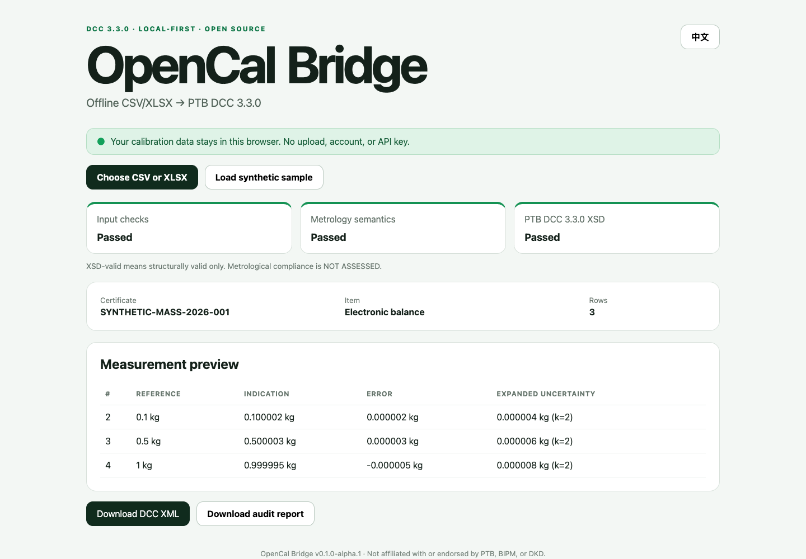

# OpenCal Bridge

[](https://github.com/maliksandra838-lgtm/opencal-bridge/actions/workflows/ci.yml)
[](https://maliksandra838-lgtm.github.io/opencal-bridge/)
[](https://github.com/maliksandra838-lgtm/opencal-bridge/actions/workflows/codeql.yml)
[](LICENSE)

**Offline Excel/CSV to PTB Digital Calibration Certificate (DCC) 3.3.0.**

[Launch the live app](https://maliksandra838-lgtm.github.io/opencal-bridge/) · [China mirror](https://gitee.com/misspop999/opencal-bridge) · [简体中文](README.zh-CN.md) · [Quick start](docs/quick-start.md) · [Data dictionary](docs/csv-data-dictionary.md) · [Validation model](docs/validation-model.md)

> Alpha software for evaluation and interoperability testing. Do not use it to
> issue a calibration certificate without your laboratory's technical review,
> authorization, and controlled process.



Calibration laboratories often already hold structured results in spreadsheets,
but turning those rows into a schema-valid DCC still requires XML and D-SI
knowledge. OpenCal Bridge provides a narrow, auditable path:

```text
CSV / XLSX → input checks → metrology warnings → DCC XML → PTB XSD validation
                                                        ↘ audit HTML
```

## Why this project exists

- **Local-first:** files are processed in the browser; no account, API key, or
  upload is required.
- **Bilingual:** English and Simplified Chinese share the same deterministic
  conversion core.
- **Auditable:** diagnostics use stable codes and point back to source rows.
- **Honest validation:** input checks, metrology warnings, and XSD validation
  are reported separately.
- **Interoperable:** generated fixtures pass both `xmllint-wasm` and native
  `xmllint` against DCC 3.3.0, D-SI 2.2.1, and XMLDSig dependencies.

The BIPM's digitalization survey found that 68% of respondents with active
digital projects were working on DCC, while practical implementation knowledge
remained uneven. OpenCal Bridge is designed as a migration bridge—not a new
certificate standard and not a replacement for PTB tools.

## Current alpha scope

Supported now:

- `.csv` and `.xlsx` first-sheet import;
- one calibrated item and one responsible person per input;
- scalar comparison points: reference value, indication, error, expanded
  uncertainty, coverage factor, and D-SI unit;
- English or Chinese DCC metadata;
- deterministic DCC 3.3.0 XML;
- in-browser XSD validation without network schema resolution;
- standalone bilingual HTML audit report;
- synthetic mass and temperature examples.

Not supported yet:

- digital signatures or seals;
- accreditation or ISO/IEC 17025 conformity decisions;
- pass/fail statements or guard bands;
- multiple items, uncertainty budgets, mapping templates, macros, `.xls`, or
  `.xlsm`;
- spatial/temporal field calibration data.

See [ROADMAP.md](ROADMAP.md) for the planned expansion.

## Run locally

Requirements: Node.js 22 or newer and npm.

```bash
npm install
npm run dev
```

Open the local URL, select one of the files in `examples/`, and confirm that all
three status cards are visible. No server receives the calibration data.

For a release-quality check:

```bash
npm run check
```

This runs generated-example checks, unit tests, a production build, deterministic
fixture generation, WASM XSD validation, and native `xmllint` cross-validation.

## Input contract

The first row must contain the fixed v0.1 headers. Metadata columns repeat on
each measurement row so that CSV remains portable and easy to inspect.

```csv
certificate_id,country_code,language,calibration_date,laboratory_name,customer_name,responsible_person,item_name,item_serial,method,result_name,reference_value,indication,error,unit,expanded_uncertainty,coverage_factor
```

See [docs/csv-data-dictionary.md](docs/csv-data-dictionary.md) for definitions,
limits, and a copy-ready example. All public examples are deterministic and
explicitly marked `SYNTHETIC`; they contain no customer or laboratory data.

## What “valid” means

| Layer | Question answered | Does not prove |
| --- | --- | --- |
| Input checks | Are required fields present and parseable? | Measurement correctness |
| Metrology semantics | Are units, formulas, `U`, and `k` internally plausible? | Standards compliance |
| PTB DCC 3.3.0 XSD | Does the XML conform structurally to the bundled schemas? | ISO/IEC 17025 conformity or authorization to issue |

The UI and report always show **Metrological compliance: NOT ASSESSED**. See
[docs/validation-model.md](docs/validation-model.md).

## Privacy and security

There is no backend, analytics, remote font, login, or API integration. The
converter places business data in memory only. It limits input to 10 MiB and
10,000 XLSX data rows. Formula cells are read from cached values and flagged;
formulas and macros are never executed.

Read [docs/privacy.md](docs/privacy.md) and [SECURITY.md](SECURITY.md) before
testing confidential material. For initial evaluation, use only the synthetic
examples.

## Schemas and licensing

Project-owned source is MIT licensed. Unmodified PTB DCC 3.3.0 and D-SI 2.2.1
schemas retain LGPL-3.0-only terms; the XMLDSig schema retains its embedded W3C
terms. Versions, sources, and SHA-256 hashes are recorded in
`public/schemas/schema-manifest.json`.

This project is independent and is not affiliated with or endorsed by PTB,
BIPM, DKD, or an accreditation body. See [NOTICE](NOTICE) and
[THIRD_PARTY_LICENSES.md](THIRD_PARTY_LICENSES.md).

## Contributing and real-world trials

The highest-value contributions are reproducible compatibility reports from
calibration laboratories, instrument vendors, proficiency-testing providers,
and national metrology communities. Never attach confidential certificates or
customer spreadsheets to a public Issue; use the synthetic reproduction
template instead.

Start with [CONTRIBUTING.md](CONTRIBUTING.md), then open a bug, compatibility,
feature, or adoption report. The current tool-level evidence is recorded in
[the alpha.1 compatibility matrix](docs/compatibility-matrix-alpha.1.md).
Maintainer responsibilities are described in [GOVERNANCE.md](GOVERNANCE.md).

## Sources

- [PTB DCC documentation](https://www.ptb.de/dcc/)
- [PTB DCC 3.3.0 schema repository](https://gitlab.com/ptb/dcc/xsd-dcc/-/tree/v3.3.0)
- [BIPM digital transformation survey, Rapport 2023/01](https://www.bipm.org/en/doi/10.59161/rapport202301)
- [BIPM DCC/DRMC Task Group](https://www.bipm.org/en/committees/fo/forum-md/wg/forum-md-tg-h-dcc/drmc)

If OpenCal Bridge saves you a manual conversion or reveals an interoperability
gap, please report the workflow—without sensitive data. Evidence beats hype.
