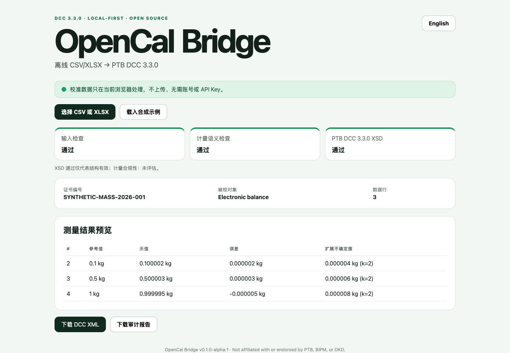

# OpenCal Bridge

**离线把 Excel/CSV 转成 PTB 数字校准证书（DCC）3.3.0。**

[English](README.md) · [快速开始](docs/quick-start.zh-CN.md) · [字段字典](docs/csv-data-dictionary.md) · [验证模型](docs/validation-model.md)

> 当前为 Alpha 评估版。未经实验室技术审核、授权和受控流程，不得用它直接签发校准证书。



很多实验室已经用 Excel 保存校准结果，但从表格生成经过 Schema 验证的 DCC，仍需要 XML 和 D-SI 专业知识。OpenCal Bridge 提供一条窄而清晰的路径：

```text
CSV / XLSX → 输入检查 → 计量语义警告 → DCC XML → PTB XSD 验证
                                                    ↘ HTML 审计报告
```

## 它解决什么问题

- **本地优先**：文件只在浏览器内处理，不登录、不上传、不要 API Key；
- **中英双语**：界面与报告支持简体中文和英文，转换核心保持一致；
- **可审计**：诊断码稳定，并回指源表行号；
- **不夸大验证**：输入检查、计量语义检查、XSD 验证分别呈现；
- **可交叉验证**：合成样例同时通过浏览器 WASM 和系统 `xmllint`。

它是现有 Excel/CSV 与 DCC 之间的迁移桥，不另造标准，也不冒充 PTB 官方工具。

## 当前能力

- 导入 `.csv` 和 `.xlsx` 的第一个工作表；
- 单一被校对象、单一责任人和多校准点；
- 参考值、示值、误差、扩展不确定度、覆盖因子和 D-SI 单位；
- 确定性生成 DCC 3.3.0 XML；
- 浏览器内离线完成 XSD 验证；
- 下载中/英文 HTML 审计报告；
- 提供明确标为 `SYNTHETIC` 的质量与温度示例。

暂不支持数字签名、合格判定、认可/ISO 17025 结论、多对象、多工作表、宏、旧版 `.xls` 和温度场时空矩阵。详见 [ROADMAP.md](ROADMAP.md)。

## 本地运行

需要 Node.js 22 或更高版本和 npm：

```bash
npm install
npm run dev
```

完整验收：

```bash
npm run check
```

该命令会运行合成示例生成、单元测试、生产构建、WASM XSD 验证和系统 `xmllint` 交叉验证。

## “通过”到底代表什么

| 层级 | 回答的问题 | 不能证明 |
| --- | --- | --- |
| 输入检查 | 必填字段是否完整、能否解析 | 测量结果正确 |
| 计量语义 | 单位、误差公式、`U`、`k` 是否内部合理 | 符合某份技术规范 |
| PTB DCC 3.3.0 XSD | XML 结构是否符合打包的 Schema | ISO/IEC 17025 合规或可签发 |

界面和报告始终明确写出：**计量合规性：未评估**。

## 隐私与许可证

项目没有后端、统计脚本、远程字体、登录或 API。业务数据默认只存在于内存；文件上限为 10 MiB，XLSX 最多读取 10,000 行。公式仅读取缓存值并发出警告，不执行公式或宏。

项目自有代码采用 MIT。PTB DCC 3.3.0、D-SI 2.2.1 Schema 保留 LGPL-3.0-only；XMLDSig 保留 W3C 条款。项目与 PTB、BIPM、DKD 或任何认可机构均无隶属或背书关系。

测试真实业务前，请先读 [隐私说明](docs/privacy.md) 和 [安全策略](SECURITY.md)。公开 Issue 严禁上传真实客户证书或实验室表格；请按 [贡献指南](CONTRIBUTING.md) 制作合成复现。
